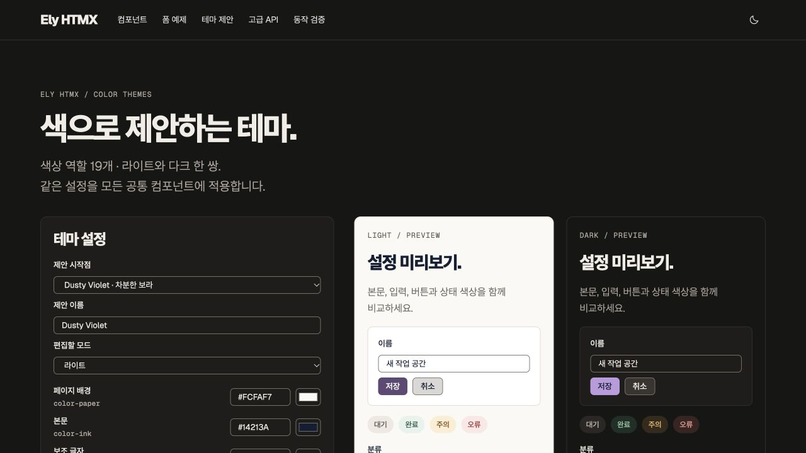

# elysdui


Independent project inspired by [Ely GPUI](https://elygpui.com/). Not affiliated with or endorsed by Ely GPUI.

Server-driven UI with Ely-inspired components for Go `html/template`, native HTML and htmx. Import a Go module, or export editable templates and assets into your own project. React and a client application framework are not required. CSS, JavaScript and fonts are embedded and served locally; consumers do not need a Node build.

We are deeply grateful to the **[Ely GPUI project](https://elygpui.com/)** and its contributors. Its visual design, component organization and examples are the foundation of this adaptation. We studied and referenced [Ely GPUI Component](https://git.zacharyzhang.com/ZacharyZhang-NY/Ely-GPUI-Components) to bring these ideas to Go, HTML and htmx. This is an independent adaptation, with the original MIT attribution retained. The basic templates also adapt [shadcn-htmx](https://github.com/productdevbook/shadcn-htmx).

This monorepo separates the standalone Go/htmx UI library, the renderer-neutral
SDUI core and platform adapters. The Go module is `github.com/mrchypark/elysdui`.
This is a breaking, unreleased layout; use this checkout until a release containing
these paths is published. The historical v0.1.0 release does not contain this
module layout or SDUI. There is no GPUI runtime adapter.

## Packages and boundaries

- [`ui/gohtmx`](ui/gohtmx), Go package `ui`: templates, components, assets and themes.
  Use it without SDUI; it has no dependency on the SDUI core or adapters.
- [`sdui`](sdui): renderer-neutral schema, registry, validation, composition and
  semantic resolution. It does not render HTML or import the UI library.
- [`adapters/gohtmx`](adapters/gohtmx), Go package `gohtmx`: HTML rendering,
  catalogue registration and browser HTTP actions, importing both core and UI.
- [`adapters/ios`](adapters/ios) and [`adapters/android`](adapters/android): bounded
  SwiftUI and Compose clients. Their shared contract is under
  [`contracts/native/profile-v1`](contracts/native/profile-v1).

See [architecture and dependency rules](docs/architecture.md).

## Projects and live demos

- [Project hub and shared architecture](https://mrchypark.github.io/elysdui/)
- [Go / HTMX component gallery](https://mrchypark.github.io/elysdui/go-htmx/)
- [Browser-only SDUI playground](https://mrchypark.github.io/elysdui/go-htmx/playground/)
- [SwiftUI and Jetpack Compose profile examples](docs/native/README.md): original seven-type profile plus a ten-type controls demo with switch, checkbox and select; not full catalogue coverage
- GPUI: a proposed integration, not implemented here. [Ely GPUI Component](https://git.zacharyzhang.com/ZacharyZhang-NY/Ely-GPUI-Components) remains a separate upstream project

## Documentation and AI agents

Start with the [documentation map](docs/README.md), [consumer quickstart](docs/gohtmx/getting-started.md), or [contributor workflow](docs/contributing.md). Coding agents should read [AGENTS.md](AGENTS.md) and the reusable [elysdui skill](.agents/skills/elysdui/SKILL.md). The [skill reference](.agents/skills/elysdui/references/workflows.md#installing-this-skill) explains installation in another project.

## Install and try

Go **1.26+**. From this repository checkout:

```sh
go run ./examples/gohtmx/minimal
# http://127.0.0.1:8095
go run ./examples/gohtmx/form
# http://127.0.0.1:8092
go run ./examples/gohtmx/gallery
# http://127.0.0.1:8091/components
```

For a separate application, follow the [local consumer setup](docs/gohtmx/getting-started.md).
After a release or reviewed published revision contains the new module, pin that
revision. Do not substitute `v0.1.0` into new-path install commands.

The [form example](examples/gohtmx/form) demonstrates server validation, an htmx HTML-fragment response, composite controls initialized after a swap, and a full-page fallback when JavaScript is unavailable. It does not store submitted data.

## Native mobile profile example

The opt-in [native SDUI slice](docs/native/README.md) uses one Go-resolved JSON profile screen with an actual SwiftUI iOS app and Jetpack Compose Android app. It includes text editing, validation, save and retry reconciliation. The separate [controls-v1 demo](examples/native-profile/README.md#expanded-native-controls) adds multiple fields, native switches, checkboxes and pickers. This is a bounded example, not native support for the full web catalogue.

## Server-driven screens (SDUI)

The [`adapters/gohtmx`](adapters/gohtmx) package uses the semantic [`sdui`](sdui) core to interpret strict, versioned JSON screens and render the Go/htmx templates. A small shared browser bridge submits native `FormData` and replaces a validated same-ID region; the browser never executes a screen definition. Basic templates and explicitly registered advanced components share property, binding, event and asset contracts.

```sh
# From this checkout; the historical v0.1.0 release does not contain SDUI.
go run ./examples/sdui/web
# http://127.0.0.1:8093
```

The [runnable example](examples/sdui/web) demonstrates a basic form, an advanced switch, server validation, uploads, partial updates and per-session state. It uses **local demo sessions, not production authentication**. Host applications must supply authentication, authorization, CSRF and business handlers. The bounded in-memory replay cache does not replace durable transaction-level idempotency.

Register browser assets once with `gohtmx.BindAssets(mux)` instead of `ui.BindAssets(mux)` for this web SDUI surface.

Use `gohtmx.CatalogueRegistry()` for 1,313 qualified catalogue names and 48 basic templates with recursive typed contracts. Screens support local typed templates, JSON Pointer bindings, conditions, stable-key repeats, declared slots and multiple action mappings. The web adapter’s `Store` validates atomic file updates and rollback; `ely validate`, `ely schema`, and `ely catalog` provide authoring tools. See the [coverage matrix](docs/sdui/sdui-roadmap.md) for tested behavior and explicit integration limits.

See the [SDUI guide](docs/sdui/sdui.md) for the JSON/API contract, extending the registry, loading external definitions, security responsibilities and explicit v1 limits.

For visual authoring, run `go run ./cmd/sdui-playground` and open
<http://127.0.0.1:8094>. The [SDUI playground](docs/sdui/sdui-playground.md) combines a
component library, layer tree, typed property editor, lossless JSON editing, inert
real-renderer preview and measured gzip/Brotli/Zstandard comparisons.


## Use in a Go application

Initialize templates and asset routes once, before serving requests:

```go
import ui "github.com/mrchypark/elysdui/ui/gohtmx"

templates, err := ui.NewTemplates()
if err != nil { return err }
// Add your own screens before the first ExecuteTemplate call.
if _, err := templates.ParseFS(screenFiles, "templates/*.html"); err != nil { return err }
if err := ui.BindAssets(mux); err != nil { return err }
```

A screen owns its form action and htmx endpoint:

```gotemplate
<link rel="stylesheet" href="/assets/app.css">
{{template "ui-component-assets"}}
<script src="/assets/theme.js"></script>
<script src="/assets/htmx.min.js" defer></script>

<form method="post" action="/profile" hx-post="/profile"
      hx-target="#profile-result" hx-swap="outerHTML">
  <label for="display-name">Name</label>
  {{template "input" (dict "ID" "display-name" "Name" "name" "Required" true)}}
  {{template "button" (dict "Type" "submit" "Label" "Save")}}
</form>
<section id="profile-result" aria-live="polite"></section>
```

Your handler validates native form values and renders a fragment for `HX-Request: true`, or a full page otherwise. The library does not register application routes, authorize users, or persist data. `BindAssets` registers individual `GET /assets/...` paths. Keep those paths available and do not register another handler for the same exact asset; other application assets can use the `/assets/` fallback or their own paths. The standalone UI assumes a root-mounted application and `/assets/` URLs.

The gallery renders the same `ui.Component` APIs used by applications. Example data belongs to the gallery; component markup, styling and behavior belong to the shared library.

For catalogue components:

```go
err := ui.RenderComponent(templates, w, ui.Component{
    Chapter: "documents", Name: "MarkdownRenderer", ID: "document-preview",
    Props: map[string]any{"Value": markdown},
})
```

Include `ui-component-assets` once, then either `ui-advanced-assets` for every family or `{{template "ui-advanced-family-assets" "workspace"}}` for that family’s CSS and JavaScript. Combine family helpers for a page that needs several families; their shared ES modules initialize once. Workspace also loads its nested forms dependency. Preload all families that later HTMX fragments can introduce, or use the all-family helper. See the [asset-loading guide](docs/gohtmx/asset-loading.md) for dependencies, dynamic-page constraints, and reproducible checks. Maps also need `ui-map-assets`. Give each component a unique ID. Host operations use `ely:action` / `ely:change` and the `mount` API in `/assets/ely-api.js`; Go handlers own external requests and business rules. See [component properties](docs/gohtmx/COMPONENTS.md) and the seven guides in `docs/gohtmx/advanced-*.md`.

## Own and customize the source

Export templates, browser assets, the catalogue and license notices to a **new** directory:

```sh
go run ./cmd/ely export -dir ./ely-ui
```

The export refuses an existing destination so it cannot overwrite your edits. It is a template-and-assets workflow, not a shadcn registry or `npx shadcn add` implementation. The Go module still supplies rendering helpers for Markdown, QR codes and component resolution.

Override only the templates you need with `templates.ParseFS` after `ui.NewTemplates()`, before rendering. Or parse your exported templates into that set. To serve your edited assets, use your own `http.FileServer` at `/assets/` **instead of** `ui.BindAssets`:

```go
assets, err := fs.Sub(exportedFiles, "ely-ui/assets")
if err != nil { return err }
mux.Handle("GET /assets/", http.StripPrefix("/assets/", http.FileServer(http.FS(assets))))
```

Do not convert untrusted strings into `template.HTML`. Normal properties and validated `Attrs` remain escaped. The Markdown helper disables raw HTML and unsafe URL schemes.

## Themes

Four presets: **Ely Neutral** (default), **Blue**, **Dusty Violet**, **Oxide Terracotta**. Each defines 19 color roles in both light and dark modes. Ely Neutral uses the upstream GPUI palette, including its high-contrast input boundaries. Saved palette choices are preserved. Component aliases derive from those roles. `/components/themes` provides light/dark previews, editing, contrast checks and JSON import/export.

The shared `button` template accepts Ely's `primary`, `danger`, and `subtle` variants as aliases for `default`, `destructive`, and `secondary`.

```js
const theme = ElyTheme.get('violet');
theme.id = 'my-theme';
theme.name = 'My theme';
ElyTheme.register(theme);
ElyTheme.apply(theme.id);
```



[Theme API](docs/gohtmx/themes.md) documents validation and browser storage. Account synchronization belongs to the host application.

## Catalogue scope

The catalogue has **44 chapters, 624 primary stories, 1,279 distinct names and 1,313 chapter-qualified names**. Related names can share one renderer; these counts are not independent full engines. The public API takes caller data; gallery fixtures remain in `internal/gallery`.

Native forms, keyboard handling, local editor interactions, tables, Markdown, QR/barcodes, map selection and host action payloads are included. AI generation, financial execution, authentication, uploads, collaboration and OS/file operations require a host service. Complex charts remain basic presentations; detailed chart work is deferred. GPUI runtime/API compatibility and complete pixel parity are not claimed. Original photos and other unverified copied media are replaced with original synthetic fixtures.

## Develop and verify

```sh
go test ./...
go vet ./...
npm ci
npm test
npm run build:css
go run ./examples/gohtmx/gallery
```

Node and Tailwind are needed only for development checks and CSS rebuilding. For browser regressions, run `npx playwright install chromium` and `npm run test:browser` after `npm ci`; CI runs this suite in its browser job. See [asset-loading verification](docs/gohtmx/asset-loading.md#browser-verification-and-measurement) for the cold-cache fixture and interpretation. Open `/components/usage` for forms and `/components/audit?aliases=1` for the browser behavior harness. Click the run button to check all chapter-qualified names with synthetic data and independent instances. This harness checks local behavior and host request contracts, not live external services. Optional media fixture regeneration: `python3 scripts/fixtures.py` (FFmpeg required).

## License and acknowledgements

Project code is **MIT**. Retain the [project license](LICENSE) and [third-party notices](THIRD_PARTY_UI.md) when copying sources. Ely GPUI and shadcn-htmx notices, font OFL licenses, htmx 0BSD, Tailwind/Lottie MIT and Natural Earth provenance remain included.
